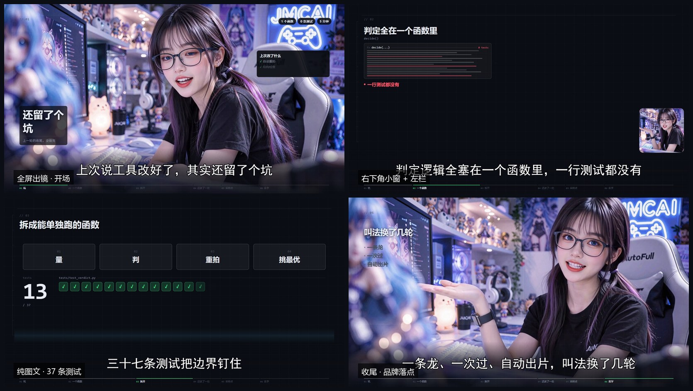

# JMCAI AutoShot: Automated Talking-Head Video Pipeline

[简体中文](README.zh-CN.md) | **English**

Turn a raw script into a fully packaged, ready-to-publish talking-head video: clone your voice, animate a portrait photo with realistic gestures, and package the video with dynamic motion graphics, subtitles, information cards, and sound effects.

**100% Local & Private Execution**: Powered by the local **JMCAI Comfypet Desktop Workflow Bridge** (`127.0.0.1:32100`) and private GPU compute targets (e.g. RTX 4090). **Zero cloud API keys, zero cloud billing**.



> All four frames come from the same 27.6-second video: full-screen opening → bottom-right PIP with a left info panel → full-frame graphics (37 tests lighting up one by one) → branded ending. The presenter rotates through three modes instead of a single pinned thumbnail.

---

## 3-Stage Pipeline

| Stage | Goal | Workflows / Tools | Outputs |
|---|---|---|---|
| **1 Voice** | Voice cloning, TTS synthesis, character-level ASR alignment | `qwen3-tts-_api` + `qwen3-asr-_api` | `merged.wav`, `words.json` |
| **2 Avatar** | Animate a portrait image with natural gestures synced to audio | `minimax-h3-copy-json` (MiniMax H3) | `final_avatar.mp4` (1080P video) |
| **3 Packaging** | Layout design: bottom-right PIP window, tech cards, subtitles, SFX | Remotion 4.x + Chromium | `final/成片_JMCAI口播一条过.mp4` |

---

## Quick Start (Deploying on a New Machine)

### 1. Install Skill

Copy or clone this directory into your WorkBuddy / Claude skills folder:

```bash
# WorkBuddy AI User Skills Directory (Recommended)
cp -r jmcai-autoshot ~/.workbuddy-ai/skills/jmcai-autoshot

# Or Claude Code Skills Directory
cp -r jmcai-autoshot ~/.claude/skills/jmcai-autoshot
```

### 2. Prerequisites

On the target machine:
1. **Launch JMCAI Comfypet Desktop**:
   - Ensure the Workflow Bridge is active (listening on `127.0.0.1:32100`).
   - Ensure the following workflows are enabled and bound to your compute target:
     - `qwen3-tts-_api` (Voice Cloning; fallback options: `qwen3-tts-_api-2`, `qwen3-tts-voicedesign-_api`)
     - `qwen3-asr-_api` (ASR with character-level timestamps)
     - `minimax-h3-copy-json` (MiniMax H3 Avatar generation)
2. **Environment Self-Check**:
   ```bash
   python scripts/setup_env.py
   ```
   Missing Python packages (numpy, cv2, Pillow, av, imageio-ffmpeg, librosa), Node.js, and Remotion runtime will be automatically downloaded and installed.

### 3. Python & Audio Dependencies (Important)

The **acoustic gate** in the voice stage (which auto-detects timbre drift and re-rolls bad takes) needs `librosa` + `scipy`. Known pitfall:

- **On Python 3.13+, `librosa` / `av` / `imageio-ffmpeg` often have no prebuilt wheels**, so `setup_env.py` will list them under `failed`. **This does not mean the skill is broken.**
- The scripts are **environment-adaptive**: if the current interpreter lacks `librosa`, they automatically locate the `python_embeded` interpreter bundled with a local ComfyUI portable install (which usually has librosa) and use it for acoustic analysis.
- To pin the interpreter explicitly (most reliable), set:
  ```bash
  # Windows
  set COMFYUI_PYTHON=D:\ComfyUI_windows_portable\python_embeded\python.exe
  # macOS / Linux
  export COMFYUI_PYTHON=~/ComfyUI/venv/bin/python
  ```
- If neither works (no librosa locally and no ComfyUI found), voice synthesis still produces audio, but **timbre verification is skipped** and no auto re-roll happens — timbre drift is then on your ears. Install librosa or point `COMFYUI_PYTHON` at a suitable interpreter.

**Recommended**: use Python 3.11 / 3.12 (best ecosystem coverage), or simply run the voice scripts with ComfyUI's own `python_embeded`.

### 4. Verify Readiness
```bash
python scripts/voice/check_key.py      # desktop app online + TTS/ASR workflows enabled
python scripts/avatar/check_setup.py   # desktop app online + avatar workflow ready
```
Both exiting 0 means you're good to go.

### 5. Generate Video

In your AI chat assistant, prompt:
> "Use jmcai-autoshot to make a talking-head video for this script"

Provide:
- **Script**: The spoken text (30-300 words recommended).
- **Voice sample**: A 3-30 second clean voice clip (cached automatically for future projects).
- **Portrait image**: A high-resolution front-facing portrait photo.

The pipeline will execute voice synthesis, avatar generation, and motion graphics packaging end-to-end, delivering the final video to `final/`.

---

## License & Privacy

- 🔒 **Completely Private**: Scripts, audio, and portrait images are processed entirely within your private local network and desktop client.
- 💰 **Zero API Costs**: No tokens, subscriptions, or SaaS credits required.
